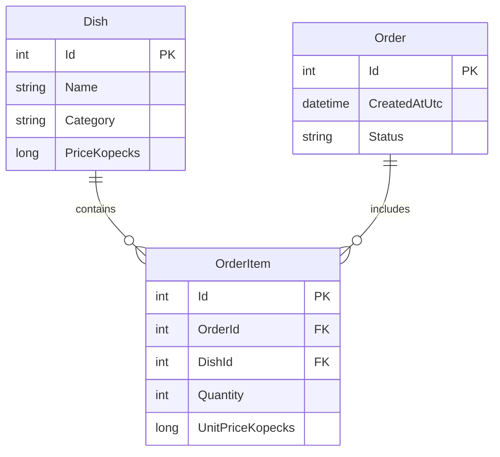

# Учёт заказов предприятия общественного питания

Учебная лабораторная по дисциплине «Командное проектирование и разработка».
Предметная область связана с ВКР о внедрении ИС на предприятии общественного питания.
Проект демонстрирует работу ORM, паттерн Repository и миграции; это не полноценная ИС предприятия.

## Стек

C#, .NET 9, Entity Framework Core 9.0.11, SQLite, NuGet, Rider.
Денежные значения хранятся целым числом копеек, чтобы избежать ошибок округления.
Цена позиции фиксируется при создании заказа и не зависит от последующего изменения цены блюда.

## Структура

- `app/models` — отдельные классы Dish, Order и OrderItem.
- `app/data` — контекст БД и настройка связей/ограничений.
- `app/repositories` — интерфейс и реализация репозитория блюд с CRUD.
- `app/migrations` — начальная миграция и снимок модели.
- `Program.cs` — проверяемая демонстрация CRUD и заказа.

## Запуск в Rider

Откройте `CateringLab.csproj`, дождитесь восстановления NuGet и запустите проект.
Если SDK не найден автоматически, укажите в настройках Rider путь `%USERPROFILE%\.dotnet\dotnet.exe`.
Файл `catering.db` создаётся в текущей рабочей папке. Он исключён из Git.
При запуске применяется миграция, выполняется CRUD, создаётся заказ на 700 рублей
и проверяется запрет удаления блюда из заказа. Демонстрационные данные откатываются
транзакцией; созданная миграцией схема БД остаётся. Повторный запуск безопасен.

## Команды из папки проекта

```powershell
dotnet restore
dotnet new tool-manifest
dotnet tool install dotnet-ef --version 9.0.11
dotnet ef database update
dotnet run
```

Миграция InitialCreate уже включена в проект. Для последующих изменений моделей:

```powershell
dotnet ef migrations add DescribeChange --output-dir app/migrations
dotnet ef database update
```

Первичная миграция создана командой `dotnet ef migrations add InitialCreate --output-dir app/migrations`.
Таблицы создаются миграцией, метод `EnsureCreated` не используется.

## Схема данных



Удаление заказа каскадно удаляет позиции. Удаление блюда, используемого в заказах,
запрещено. БД проверяет положительное количество и неотрицательную цену.

## Проверка

Начальная миграция применена к SQLite. Демонстрация успешно проверяет создание,
чтение, обновление и удаление блюда, сохранение заказа и защиту связей.

## GitHub и сдача

Нужны публичный репозиторий, ветка с реализацией и pull request в main.
GitHub не позволяет автору одобрить собственный PR: approve должен сделать
преподаватель или другой участник с необходимыми правами.

Документация: [EF Core и SQLite](https://learn.microsoft.com/en-us/ef/core/get-started/overview/first-app?tabs=netcore-cli).
